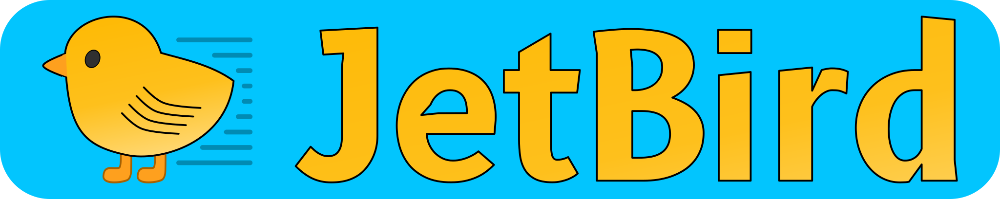
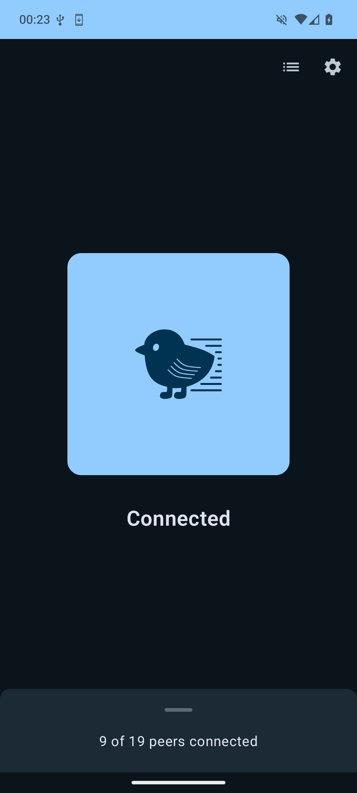
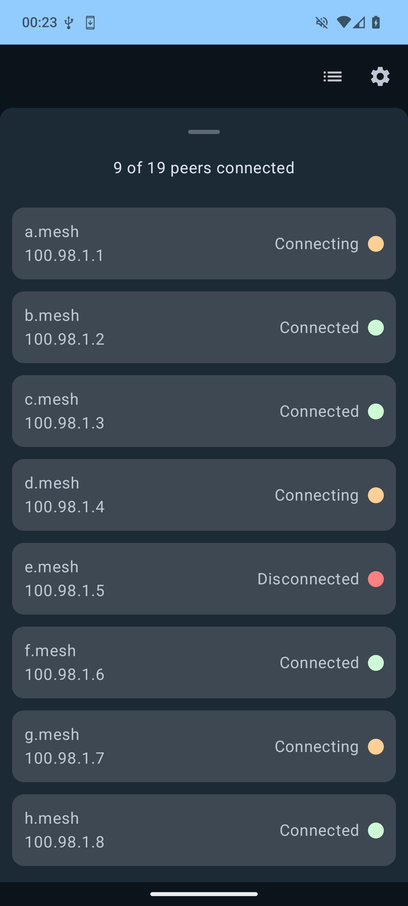
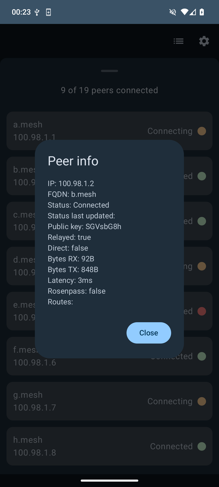
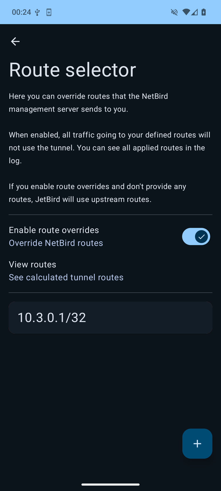
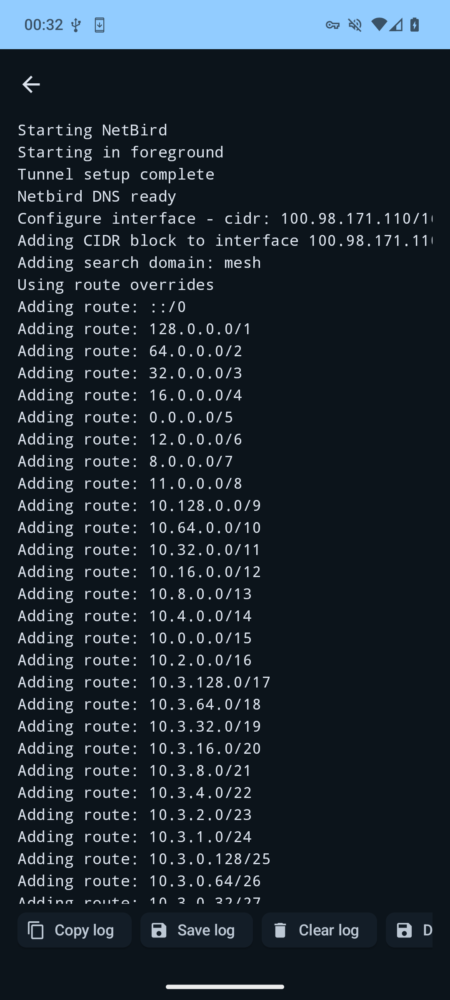
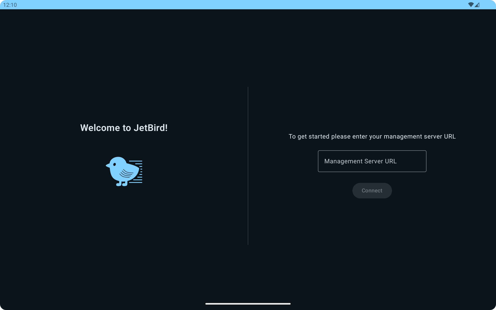
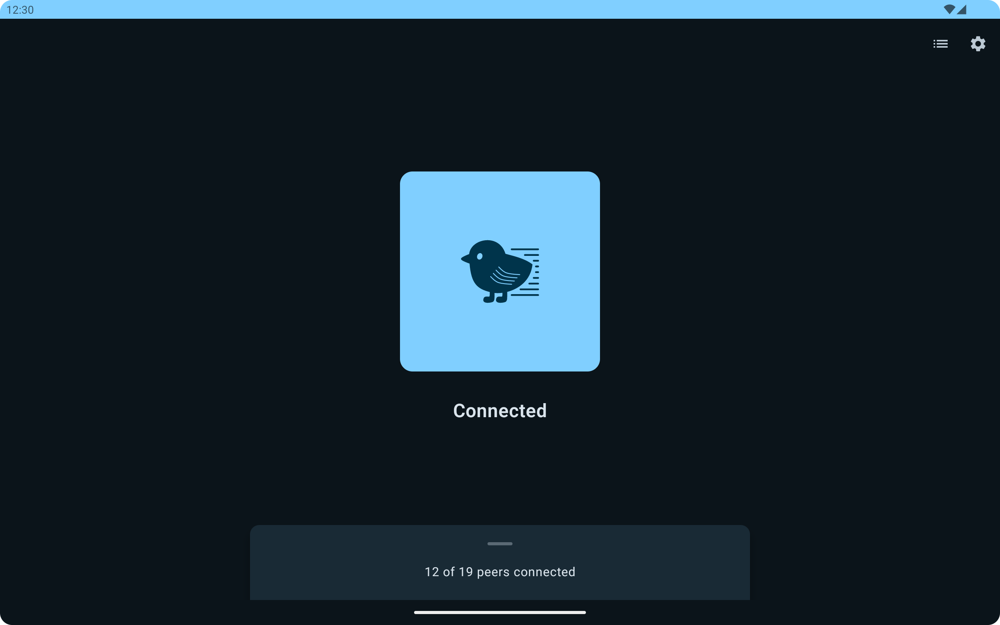
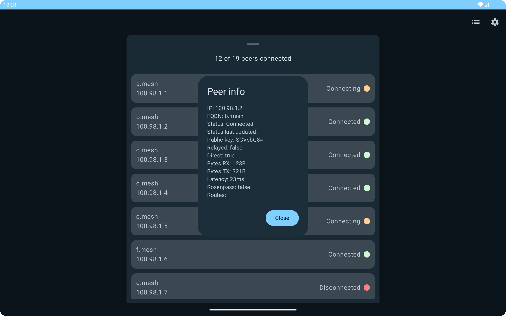
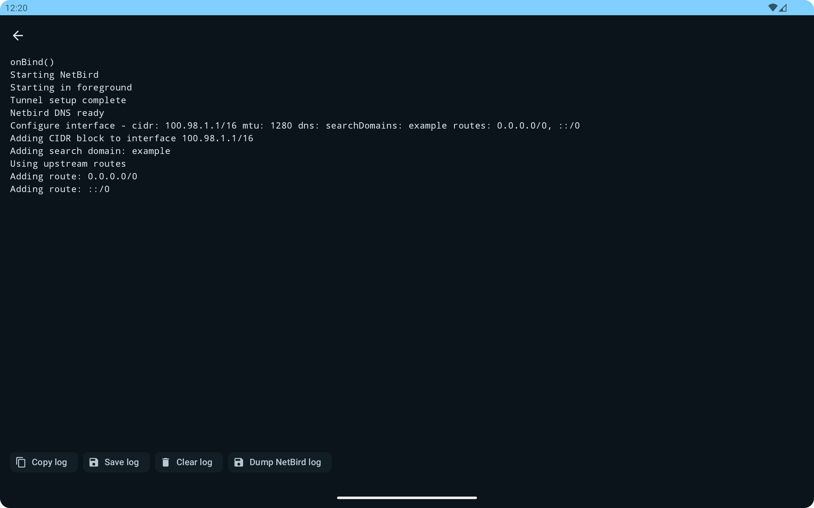

<div align="center">


[](https://shields.rbtlog.dev/dev.bg.jetbird)
<p>An unofficial, FLOSS, native Android NetBird client built with privacy in mind</p>
</div>

## About
JetBird is an implementation of the NetBird client for Android.

It has been built with privacy in mind and contains no blobs or trackers.

## Features
- Native UI
- Use SSO or setup keys
- Use pre-shared keys
- See all logs in real time
- Quick tile
- Exclude apps from the tunnel
- Exit nodes (with selection and client-side customisation)
- Tablet support
- Reconnect on restart
- Relay support from JetBird v1.0.4+ (with NetBird v0.29.0+ peers)
- TV support
- Lazy connection support - [NetBird docs](https://docs.netbird.io/how-to/lazy-connection)
- External broadcast receiver for automation (e.g. via Tasker)

## Differences
There are a few differences between NetBird official Android client and JetBird. Some of these features rely on patches to the NetBird source (these are in `patches/`):
- See all peer info
- Use setup keys even with SSO support
- Rosenpass support
- Split tunneling via routes and/or per app
- l18n

## Install
### Prebuilt binaries
- Available to download in the [releases](https://codeberg.org/bg443/JetBird/releases) tab
- You can see the steps of the build on [JetBird's CI page]()
- Where possible, download the specific build for your device's architecture because the NetBird client is ~25MB and downloading the universal version will download all 4 architectures regardless of if you need them

<br />
<div>
    <a href="https://apt.izzysoft.de/fdroid/index/apk/dev.bg.jetbird" rel="noopener noreferrer" target=_blank></a>&nbsp;&nbsp;&nbsp;
    <a href="https://f-droid.org/en/packages/dev.bg.jetbird" rel="noopener noreferrer" target=_blank></a>&nbsp;&nbsp;&nbsp;
    <a href="https://codeberg.org/bg443/JetBird/releases" rel="noopener noreferrer" target=_blank></a>&nbsp;&nbsp;&nbsp;
    <a href="https://github.com/ImranR98/Obtainium" rel="noopener noreferrer" target="_blank"> </a>&nbsp;&nbsp;&nbsp;
    <a href="https://codeberg.org/bg443/JetBird/releases.rss" rel="noopener noreferrer" target=_blank></a>
</div>

### APK Signature
```
dev.bg.jetbird
39:56:53:3C:54:22:18:34:9B:5F:3F:7F:3D:3A:69:26:06:0C:1A:0C:DF:32:D6:E5:8E:A1:DE:3A:36:C2:12:13
```

### Build from source

1. Build NetBird
```
./scripts/build_netbird.sh
```
JetBird's NetBird client patches will be applied automatically.

2. Build APK
```
./gradlew :app:assembleRelease
```

## Privacy
JetBird does not, and never will, call home.

JetBird/NetBird has to talk to your management server, which will have it's own privacy policy.

In the NetBird management portal, admins will be able to see:
- You are using JetBird
- JetBird and NetBird versions
- Device model e.g. Pixel 9 Pro Fold
- Operating system e.g. Android 14

JetBird makes no extra connections or requests outside of the NetBird client.

## Permissions
JetBird requires a few permissions in order to function:
- `INTERNET`
- `FOREGROUND_SERVICE`/`FOREGROUND_SERVICE_SYSTEM_EXEMPTED` - used to run the VPN service
- `ACCESS_NETWORK_STATE`/`CHANGE_NETWORK_STATE` - used to monitor network to check if VPN is already running etc.
- `POST_NOTIFICATIONS` - used for notifications when JetBird is running and when upstream sends new routes
- `QUERY_ALL_PACKAGES` - used so you can choose which apps aren't tunneled
- `RECEIVE_BOOT_COMPLETED` - used to start the tunnel when the device reboots - this is disabled by default in the manifest and will enable itself once you enable it in settings

## Notifications
Notifications are optional but Android requires JetBird to show a notification when the tunnel is running. This is dismissible on Android 13+.

## Screenshots
### Phone
<div align="center">





</div>

### Tablet
<div align="center">




</div>

## Issues
As JetBird is just a wrapper around the official NetBird client, most connection/peer/management issues will reside with upstream.

Please open an issue using the template provided if you believe you have found a bug or have a feature request!

## Translations
You can contribute to JetBird translations [here](https://translate.codeberg.org/projects/jetbird/app)

<a href="https://translate.codeberg.org/engage/jetbird/">

</a>

## Libraries

See a full list of libraries used [here](https://codeberg.org/bg443/JetBird/wiki/Libraries)

## License

<br />

JetBird is free software: you can redistribute it and/or modify it under the terms of the [GNU GPL-3.0-or-later License](./LICENCE.md) as published by the Free Software Foundation.

This software is provided with no warranty.

## Other
"NetBird" and the "NetBird" logo are <a href="https://netbird.io/terms" rel="noopener noreferrer" target=_blank>copyright</a> owned by or licensed to Wiretrustee UG.

"WireGuard" and the "WireGuard" logo are registered <a href="https://www.wireguard.com/trademark-policy" rel="noopener noreferrer" target=_blank>trademarks</a> of Jason A. Donenfeld.

"IzzyOnDroid" and the "IzzyOnDroid" logo are registered trademarks of <a href="https://www.izzysoft.de" rel="noopener noreferrer" target=_blank>IzzySoft</a>.
